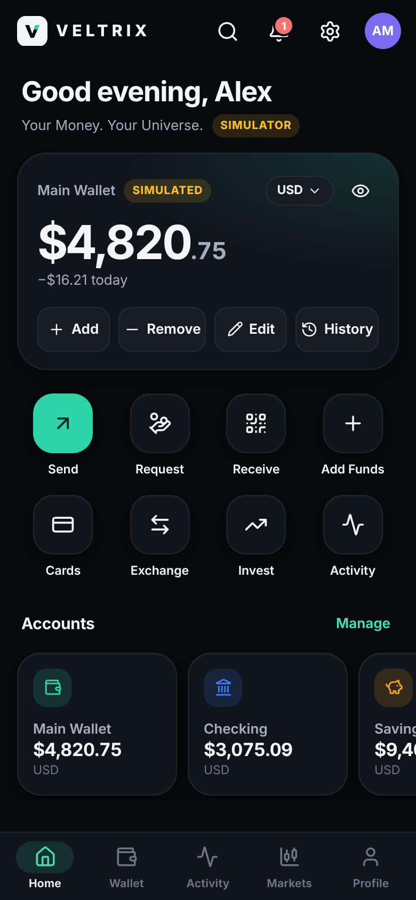
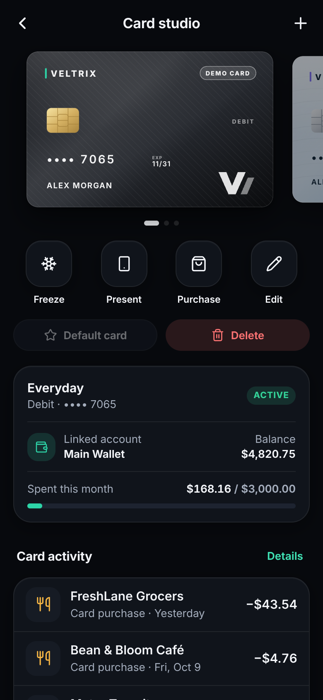
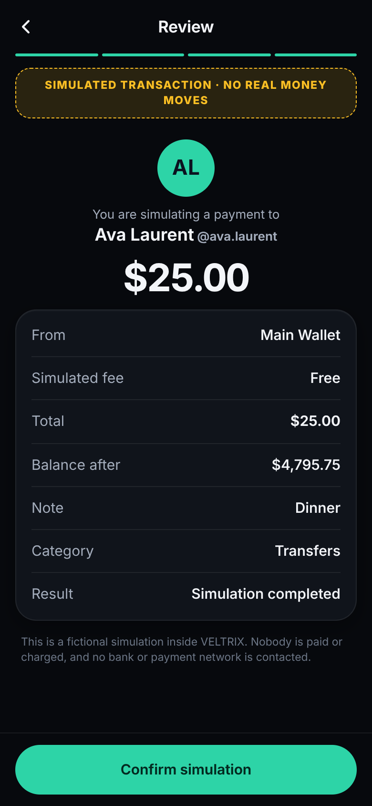
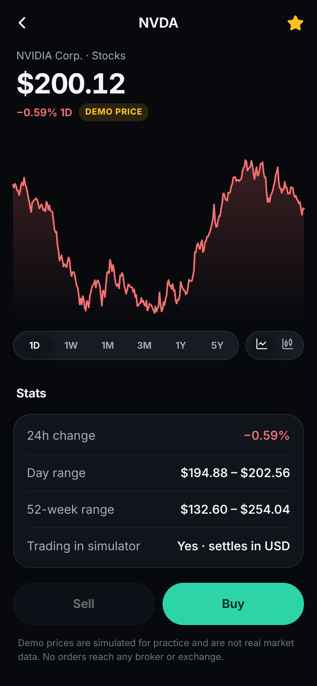
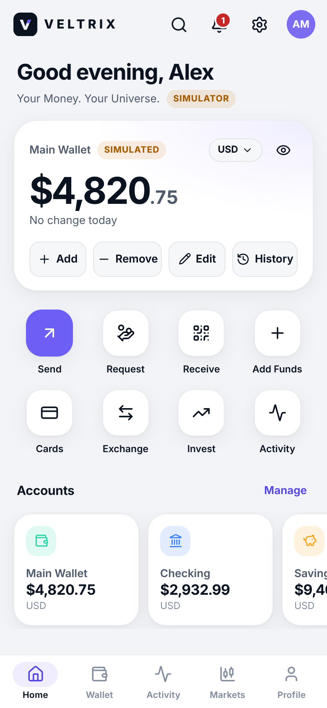
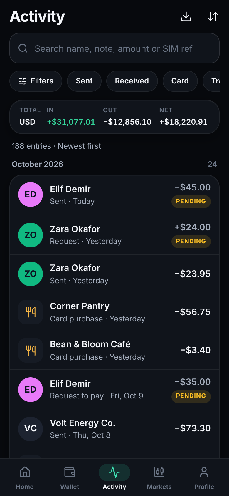
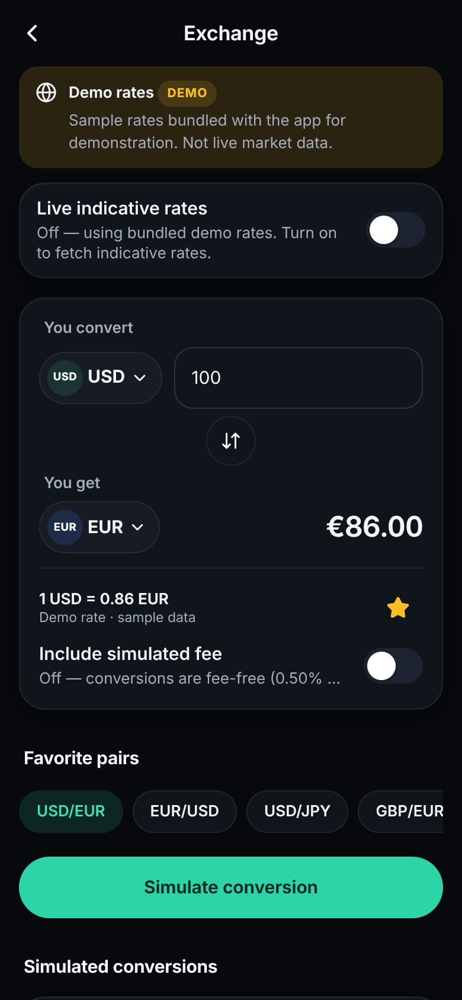
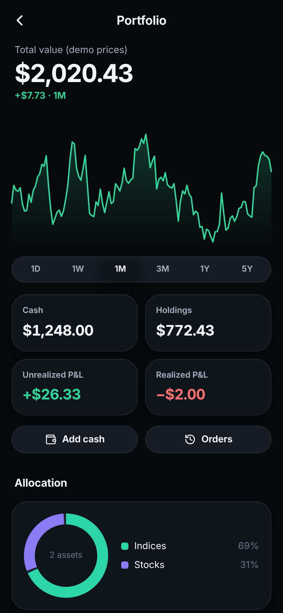

# VELTRIX Wallet

**Your Money. Your Universe.** A premium, offline-friendly fintech **simulator** for Android.

> **Everything in VELTRIX is fictional.** Every balance, transfer, card, account, credit figure and trade is simulated and labelled as such. The app does not connect to banks, card networks, brokers or payment providers, never asks for real credentials, and cannot move real money.

<p align="center">
  
  
  
  
</p>
<p align="center">
  
  
  
  
</p>

## Download

| | |
|---|---|
| **APK** | [`release/VELTRIX-Wallet-v1.0.0.apk`](release/VELTRIX-Wallet-v1.0.0.apk) (≈ 445 KB) |
| Checksum | [`release/VELTRIX-Wallet-v1.0.0.apk.sha256`](release/VELTRIX-Wallet-v1.0.0.apk.sha256) |
| App ID / version | `com.veltrix.wallet` · 1.0.0 (versionCode 1) |
| Android | 7.0+ (API 24), target API 35 · needs an up-to-date Android System WebView (Chrome 87+) |
| Signature | APK Signature Scheme v2 + v3, public **development** key ([details](android/keystore/README.md)) |

Install with `adb install release/VELTRIX-Wallet-v1.0.0.apk`, or copy the file to a phone and open it (allow installing from that source).

The APK was built and **statically verified** in this repository's environment (signature, zip alignment, manifest, resources, dex). No emulator was available here, so it has not been run on a device yet — see [Environment limitations](#environment-limitations).

## What's inside

- **Home** — wordmark, avatar, greeting, notifications, settings; a big balance card (show/hide, display currency, add/remove/edit funds, history), eight working quick actions, renamable/hideable account tiles and configurable sections (recent activity, monthly income/spend, category donut, 30-day trend, upcoming bills, goals, favourite contacts and currencies, card activity, mini watchlist).
- **Send · Request · Receive** — recipient (saved, search or new fictional contact) → keypad amount (presets, fee preview, available balance, validation) → note (presets, 140-grapheme limit, emoji) → review with a **SIMULATED TRANSACTION** banner → result with reference and details. Requests can be marked accepted or canceled; incoming requests paid or declined. The receive screen shows a demo QR with fictional data only, a copyable fictional wallet ID, shareable demo text and a manual incoming-payment simulation.
- **Card studio** — 10 materials (Obsidian, Glacier, Emerald, Royal, Aurora, Carbon, Pearl, Neon, Midnight Blue, Custom), patterns, accents, original network marks, debit/credit/prepaid, limits, per-card history, freeze/unfreeze, rename, reorder, set default, delete, phone presentation mode and a home-screen widget. Cards carry a permanent **DEMO CARD** label, only four display digits and no CVV.
- **Accounts** — main wallet, checking, savings, virtual card, FX balances, investment cash and a simulated credit line whose limit / used / available / utilization are validated and derived from each other; monthly summaries and history per account.
- **Ledger** — 11 entry types with balance before/after; search, filters (type, status, category, account, card, date, amount), four sort orders, monthly grouping, totals in/out/net, details, complete/cancel pending, reverse/refund and safe deletion.
- **Wallet tab** — an original, PayPal-inspired hub: currency balances, requests, contacts, payment activity, refunds, note history with search and notification preferences.
- **FX converter** — USD, EUR, GBP, CHF, JPY, CAD, AUD, ALL, TRY (+7 more), swap, rate and timestamp, favourite pairs, history, optional fee; bundled **demo** rates offline, optional **indicative** live rates (ExchangeRate-API, opt-in). Simulated conversions update FX accounts with a full calculation breakdown.
- **Markets simulator** — FX pairs, indices, stocks, gold/silver and crypto with clearly labelled **demo prices**; search, watchlist, line/candle charts (1D–5Y), buy/sell with hypothetical fees, review & confirm, positions with average cost, realized/unrealized P&L and order history.
- **Analytics** — income, spending, net, averages, largest entries, category/account/card breakdowns, daily/weekly/monthly trends, like-for-like previous-period comparison and custom ranges — computed from the local ledger only, with empty states.
- **Extras** — setup wizard with five presets (Minimal, Everyday Banking, Premium, Investor Demo, Empty Sandbox), savings goals, budgets, subscriptions and scheduled transfers, bill reminders, global search, a decimal-exact calculator, CSV export, validated backup/restore, app lock (device credential), reset demo, light/dark/system themes with themed system bars, six accents and adjustable motion.

## Safety & privacy by design

- Integer minor-unit money with explicit currencies; transfers conserve value except fees; no currency mixing without a recorded conversion rate.
- Every balance change is a ledger entry. Manual edits are visible adjustments; deletions are only allowed for entries that never moved money (or reversed pairs that net to zero).
- Data stays on the device (app-private files, written atomically). Android backup and device transfer are disabled.
- The only permission is `INTERNET`, used solely for the optional indicative FX-rate download. Simulated transactions never touch the network. No background services, no system notifications, no analytics or trackers.
- Demo prices and rates are never presented as live; indicative rates carry a disclosure and attribution.

## Build it yourself

Prerequisites: **Node 18+** (developed with Node 22), git, bash, python3, zip. No Android Studio, Gradle or Maven access is required for the reference build.

```bash
# 1) Web app (the UI that ships inside the APK)
cd app
npm ci
npm run dev          # live preview on http://localhost:5173
npm run typecheck    # TypeScript strict mode
npm test             # unit + property tests (Vitest + fast-check)
npm run build        # production bundle → app/dist

# 2) Android APK (reference build: aapt2 + javac + d8 + zipalign + apksigner)
cd ..
tools/setup-toolchain.sh   # fetches JDK 17 + Android API 35 build tools from public AOSP mirrors on GitHub
tools/build-apk.sh         # tests → bundle → compile → dex → align → sign → verify → release/

# 3) End-to-end UI tests against the production bundle
cd tools/ui-test && npm ci && npm test          # or: npm run test:shots (refreshes docs/screenshots)
```

**Android Studio / Gradle:** `android/` is also a standard Gradle project (AGP 8.7.3, Gradle 8.10.2 wrapper, JDK 17). Build the web bundle first (`cd app && npm ci && npm run build`), then open `android/` in Android Studio or run `./gradlew assembleDebug`. Gradle could not be executed in the environment this was developed in (Maven/Google repositories are blocked there); the GitHub Actions workflow runs it on every push, and the [first run](https://github.com/diamantmuqici-dotcom/VELTRIX-WALLET/actions/runs/38177537425) built the debug APK successfully.

To sign with your own key: `VELTRIX_KEYSTORE=… VELTRIX_KEY_ALIAS=… VELTRIX_STORE_PASS=… VELTRIX_KEY_PASS=… tools/build-apk.sh`.

## Project structure

```
app/                     React + TypeScript UI and domain logic (Vite)
  src/domain/            pure, framework-free simulator core: money, ledger, ops, FX, markets, analytics, presets, schema
  src/state/             single store (useSyncExternalStore), persistence, navigation/sheets/toasts, live-rate fetcher
  src/ui/                design tokens (theme.css), component styles, charts, demo card renderer, primitives
  src/screens/           every screen and flow
  tests/                 Vitest unit + fast-check property tests
android/                 native Android shell (Java, platform APIs only — no AndroidX)
  app/src/main/java/…    MainActivity (WebView host), WebAppBridge, AssetServer, CardWidgetProvider
  app/src/main/res/      themes (light/dark, splash), adaptive icon, widget, backup rules
  keystore/              public development signing key
tools/
  setup-toolchain.sh     fetch the minimal Android toolchain
  build-apk.sh           Gradle-free build + verification
  ui-test/               Puppeteer end-to-end tests (own package.json)
  icons/                 renders legacy PNG icons + widget preview from SVG
release/                 the verified APK and its SHA-256
docs/                    architecture, testing, screenshots
.github/workflows/ci.yml unit tests, reference APK build, UI tests, Gradle build
```

## Dependencies

| Package | Version | Purpose |
|---|---|---|
| react, react-dom | 19.1.9 | UI |
| lucide-react | 0.577.0 | icons (ISC) |
| big.js | 7.0.1 | decimal maths for rates, prices and quantities |
| qrcode-generator | 2.0.4 | demo QR codes |
| @fontsource-variable/inter | 5.3.0 | bundled Inter typeface (OFL), Latin + Latin Extended |
| vite · @vitejs/plugin-react | 6.3.7 · 4.7.0 | build / dev server |
| typescript | 5.8.3 | strict type checking |
| vitest · fast-check | 3.2.7 · 4.10.2 | unit and property-based tests |
| puppeteer-core · @sparticuz/chromium | 25.13.0 · 153.0.0 | end-to-end UI tests (tools/ui-test) |
| @resvg/resvg-js | 2.6.2 | icon rendering (tools/icons) |

The Android shell uses only Android platform APIs (no third-party Java libraries). Toolchain: OpenJDK 17.0.2, android.jar API 35, aapt2 2.19, D8 8.6.2, apksigner 0.9.

## Test results

Latest run (2026-10-11):

- **Unit & property tests:** 114 / 114 passed across 10 files: money parsing and formatting, payments, credit, cards, contacts, FX, markets and portfolio maths, presets, analytics, search and filters, CSV, backup/schema validation, planning, calculator. Property tests run random sequences of up to 40 operations through the ledger (300 runs) and check that balances always equal the sum of ledger effects, asset accounts never go negative, credit stays within its limit and transfers conserve value.
- **End-to-end UI tests:** 19 / 19 passed against the production bundle with its CSP: setup wizard, send/refund/request/receive, balance edits, card studio, exchange, markets, ledger search/sort, CSV and backup round-trip, persistence and corruption recovery, back navigation, theming, the native-bridge contract, a 20,000-entry history (validate ≈ 0.1 s, apply ≈ 0.4 s, Activity ≈ 0.5 s), accessibility smoke checks and zero console errors or CSP violations.
- **APK verification:** apksigner verify (v2 + v3), `zipalign -c -p 4`, `aapt2 dump badging` (package, SDK levels, single permission, launcher activity, widget), uncompressed `resources.arsc`, dex header check.
- **CI on a clean GitHub runner** ([run](https://github.com/diamantmuqici-dotcom/VELTRIX-WALLET/actions/runs/38177537425)): unit tests, the toolchain APK build from scratch, the end-to-end UI tests and the Gradle build all passed.

Details: [docs/TESTING.md](docs/TESTING.md) · Architecture: [docs/ARCHITECTURE.md](docs/ARCHITECTURE.md)

## Environment limitations

This project was built in a sandbox with no Android emulator (no KVM) and with Google Maven, Maven Central and Gradle download hosts blocked. Consequences:

1. **The APK has not been launched on a device or emulator here.** It is verified statically, and the web layer it hosts passes the end-to-end tests in Chromium, including a contract test of the JavaScript bridge against a mock with the same interface as `WebAppBridge.java`. On-device behaviour (WebView rendering, insets/keyboard, back gesture, file pickers, share sheet, app lock, widget) still needs a manual pass — see the checklist in [docs/TESTING.md](docs/TESTING.md).
2. **Framework choice.** Kotlin + Jetpack Compose (and Flutter or React Native) need Gradle and Maven artifacts that could not be downloaded here, so the app uses a native Java shell with a React UI in a WebView, built with the Android SDK's own tools. This is the one framework in the repository; there are no parallel half-built implementations.
3. **The Gradle build was not executed locally** (Maven blocked). It runs in CI, where it [passes](https://github.com/diamantmuqici-dotcom/VELTRIX-WALLET/actions/runs/38177537425); the resulting artifact could not be downloaded into this sandbox for inspection.
4. **Live indicative FX rates could not be fetched from this sandbox** (outbound host blocked). The parsing, validation, staleness and disclosure logic is unit-tested with sample payloads; the app falls back to labelled demo rates.
5. **No Google/Apple Wallet provisioning** — it is not possible for fictional cards and is not claimed. The home-screen widget and in-app presentation mode are the alternatives.

## Trademarks

VELTRIX uses only original designs. Card network marks are fictional; no bank, card network or payment-provider branding is reproduced. Company and index names in the market simulator are used for illustration only, with demo prices.
